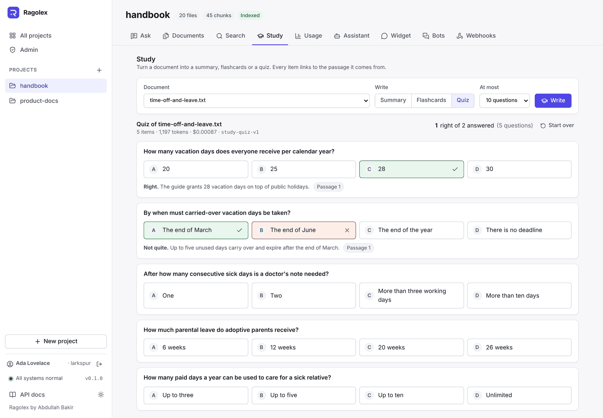
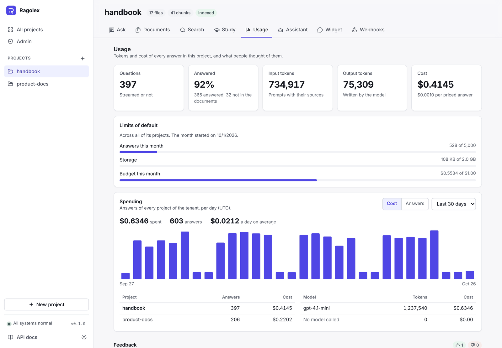
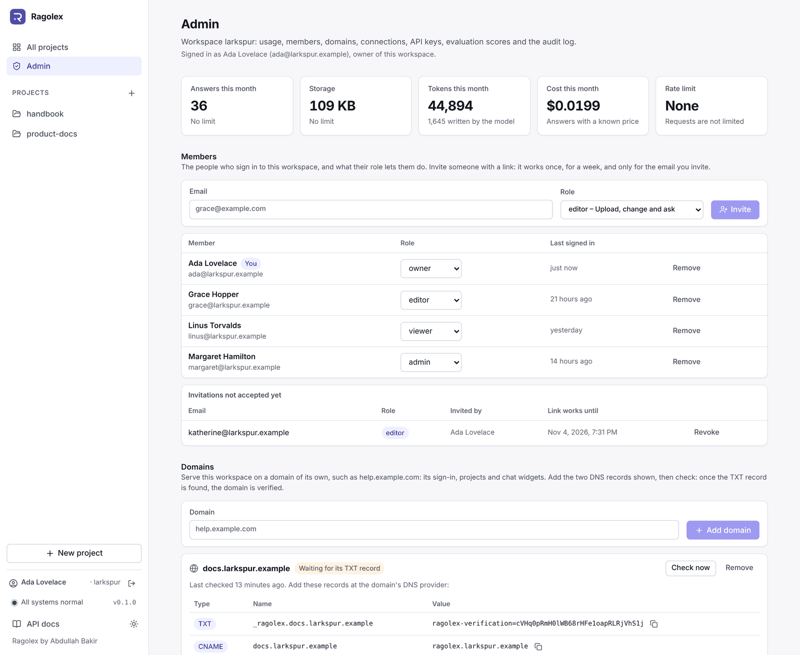

# Ragolex

> A retrieval-augmented generation (RAG) platform with a web app: bring in documents, websites and repositories, ask questions, and get answers that cite the passages they come from, for any number of apps, sites and agents from one deployment.

[](https://github.com/AbdullahBakir97/Ragolex/actions/workflows/ci.yml)     [](./LICENSE)

<p align="center">
  
</p>
<p align="center"><sub>A question with several parts in research mode: the model plans the searches, and every claim cites its passage. Sample data.</sub></p>

## Features

### Ask and search

- **Ask** questions and get answers with citations to the file, page or section, and chunk, streamed as they are written if you like, or an explicit "no answer" when the documents don't say.
- **Research mode** for questions with several parts: the model plans up to four searches, searches again for whatever is still missing, and answers with sources for every part, within step and cost limits.
- **Follow up** in conversations: a follow-up question is rewritten into a standalone one before searching, and the questions and answers are kept, with thumbs up or down on each answer.
- **Search** by meaning and by words at once (hybrid search: pgvector and PostgreSQL full-text search, merged by rank fusion), optionally reranked by any server with the common `/rerank` API, and filtered by file, tag, page, upload date or metadata.
- **Give each project an assistant** with a name and instructions on tone and style; it still answers only from the documents.

### Bring documents in

- **Upload** PDF, Word (`.docx`), Markdown, HTML, text and source code files into separate projects. The type is checked from the content, the size limit is enforced while streaming, duplicates are found by content hash, and uploads can be scanned with ClamAV.
- **Read scanned PDFs** with OCR, by Tesseract or a vision model.
- **Process** files into chunks that respect paragraphs, with exact overlap between chunks, page numbers for PDFs, the section headings for Markdown, HTML and Word files, and one function or class at a time for source code in 12 languages.
- **Index** chunks as embeddings with OpenAI or any OpenAI-compatible server, such as Ollama, in background jobs with progress and retries, run by the API or by separate workers.
- **Sync websites, feeds and GitHub repositories**: website pages are crawled within the site, obeying robots.txt; RSS and Atom entries and a repository's documents are read; all are indexed and kept up to date on a schedule, with new, changed and removed pages handled.
- **Tag** files into collections, and limit search, answers, widgets and agent tools to some tags.

### Learn from documents

- **Study** a document: a summary, flashcards or a multiple-choice quiz, every item linked to the passage it comes from.
- **Review** flashcards in decks by spaced repetition, and export them to Anki.

### Build on it

- **Embed a chat widget** in any website with one `<script>` tag: streamed answers with clickable citations, in the site's colour and with its logo, allowed only on the websites you list, without API keys in the page.
- **Use the [TypeScript and Python SDKs](sdk/README.md)**, generated from the OpenAPI schema and checked against the API in CI: every endpoint typed, streamed answers, uploads and jobs.
- **Connect agents** through a built-in MCP server (`/api/v1/mcp`) with `list_projects`, `search_knowledge` and `ask` tools, or the same tools as function-calling schemas.
- **Automate** with signed webhooks: uploads, deletions, finished jobs and budget alerts are sent to n8n, Make, Zapier or any URL, retried for a day until received.
- **Rely on a stable API**: `/api/v1` only grows, CI fails on breaking changes, and retired endpoints announce their end in headers at least six months ahead.

### Serve several apps

- **Tenants** keep their projects apart on one deployment. API keys with scopes (`read`, `write`, `ask`, `admin`) say what each app may do, within its own rate limit, monthly quotas and budget.
- **Track cost**: the tokens and cost of every answer, spending per day, project and model, and a monthly budget that alerts at 80% and stops answers at 100%.
- **Administer** a tenant in the web app: its API keys, usage, cost, evaluation scores over time and the audit log of who changed what.
- **Export** everything a tenant has as one ZIP archive, or delete it all.

### Quality, security and operations

- **Evaluate** with `ragolex eval` on versioned datasets: hit rate, recall and MRR, checked in CI with a real embedding model so a change that makes search worse fails. With `--answers`, answers are graded too: citation precision, groundedness and correctness. Every run is recorded, rated answers become new test cases, and `ragolex tune` finds the chunk size and overlap that search best.
- **Resist prompt injection**: document text is quoted as data in every prompt, with tags disguised by invisible or look-alike characters caught, tested against known attacks in CI and measured on an adversarial dataset.
- **Encrypt** uploaded files and webhook secrets at rest, with key rotation.
- **Operate** it with request ids on every log line (text or JSON), Prometheus metrics, OpenTelemetry tracing of requests, queries, searches, answers and jobs, and backups of the database and files together with tested restores.
- **Deploy** automatically: every merge runs on staging and every release tag on production, from images built once, going back to the previous release on its own when a deployment isn't healthy.
- **Tested** by more than 1,200 backend tests with a 95% coverage threshold, Vitest unit tests, and Playwright end-to-end and accessibility checks of every page; dependencies and secrets are scanned in CI.

Next on the [roadmap](docs/roadmap.md): user accounts with roles per tenant, a custom domain per tenant, OAuth connectors for Notion and Google Drive, and Telegram, Slack and WhatsApp bots.

## Web app

Everything above in the browser: projects, drag-and-drop uploads, conversations with streamed answers and clickable sources, search, study, usage and administration, in light and dark and on phones. It uses only the public API. See [Web app](docs/web.md) for every page.

<table>
  <tr>
    <td width="50%"></td>
    <td width="50%"></td>
  </tr>
  <tr>
    <td align="center"><sub><b>Documents</b>: uploads, chunks and tags</sub></td>
    <td align="center"><sub><b>Study</b>: summaries, flashcards and quizzes</sub></td>
  </tr>
  <tr>
    <td width="50%"></td>
    <td width="50%"></td>
  </tr>
  <tr>
    <td align="center"><sub><b>Usage</b>: spending, limits and budget</sub></td>
    <td align="center"><sub><b>Admin</b>: API keys, evaluation and audit log</sub></td>
  </tr>
</table>

## How it works

Documents are indexed once: uploaded, read, split into overlapping chunks, embedded and stored in PostgreSQL with pgvector. Every question is then embedded with the same model, the closest chunks above a minimum score become numbered sources, and the language model answers only from them, citing each one.

<p align="center">
  
</p>
<p align="center"><sub>How an answer is made, with sample data · <a href="docs/media/how-an-answer-is-made.mp4">MP4</a></sub></p>

<p align="center">
  
</p>
<p align="center"><sub>One run from upload to cited answer, with sample data · <a href="docs/media/live-trace.mp4">MP4</a></sub></p>

<p align="center">
  
</p>

## Quick start

### With Docker

Requires only Docker. One command starts PostgreSQL with pgvector, applies the migrations, and serves the API and the web app:

```bash
git clone https://github.com/AbdullahBakir97/Ragolex.git
cd Ragolex
cp .env.example .env             # Windows: copy .env.example .env; then add your API key
docker compose up --build
```

Open **http://localhost:3000** for the web app. If a port is already in use, set another one in `.env`, e.g. `WEB_PORT=3001` (see [Docker ports](docs/configuration.md#docker-ports)).

### With Python

Requires Python 3.11+ and Docker for the database. Use this to work on the code: the API reloads on every change.

```bash
git clone https://github.com/AbdullahBakir97/Ragolex.git
cd Ragolex

python -m venv .venv
source .venv/bin/activate        # Windows: .venv\Scripts\activate
pip install -e .

cp .env.example .env             # Windows: copy .env.example .env
docker compose up -d db          # PostgreSQL 16 with pgvector on localhost:5432
alembic upgrade head             # create or update the database tables
uvicorn ragolex.main:app --reload

cd frontend && npm install && npm run dev   # optional: the web app on http://localhost:5173 (Node 22.12+)
```

Either way, **http://localhost:8000** shows the interactive API docs. Run commands from the repository root, where `.env` is read. Indexing, search and answers need `OPENAI_API_KEY` in `.env`, or OpenAI-compatible servers in `EMBEDDING_BASE_URL` and `LLM_BASE_URL`.

### Try it

```bash
curl -F "file=@notes.txt;type=text/plain" http://localhost:8000/api/v1/data/upload/demo
# {"signal": "file_uploaded_successfully", "file_id": "a16q20nzrtvj_notes.txt"}

curl -X POST http://localhost:8000/api/v1/data/process/demo \
  -H "Content-Type: application/json" -d '{"file_id": "a16q20nzrtvj_notes.txt"}'
curl -X POST http://localhost:8000/api/v1/index/demo

curl -X POST http://localhost:8000/api/v1/search/demo \
  -H "Content-Type: application/json" -d '{"query": "What do my notes say about overlap?"}'
curl -X POST http://localhost:8000/api/v1/ask/demo \
  -H "Content-Type: application/json" -d '{"question": "What do my notes say about overlap?"}'
```

## Documentation

| | |
|---|---|
| [Configuration](docs/configuration.md) | Every setting, with defaults |
| [API](docs/api.md) | Endpoints, requests, responses and errors |
| [SDKs](sdk/README.md) | The TypeScript and Python clients |
| [API versioning](docs/versioning.md) | What may change within `/api/v1`, and how endpoints are retired |
| [Architecture](docs/architecture.md) | Layers, rules and extension points |
| [Web app](docs/web.md) | Pages, how it is built, running it |
| [Evaluation](docs/evaluation.md) | Datasets, retrieval and answer metrics, prompt injection, tuning and the CI check |
| [Operations](docs/operations.md) | Health, logs, metrics, tracing, budgets, encryption at rest, and backups with tested restores |
| [Deployment](docs/deployment.md) | Staging and production from GitHub, releases and rollbacks |
| [Development](docs/development.md) | Tests, migrations and workflow |
| [Roadmap](docs/roadmap.md) | Completed and planned work |

## Tech stack

FastAPI · PostgreSQL 16 with pgvector · SQLAlchemy 2 (async) and Alembic · OpenAI-compatible embedding, chat and reranking models · pypdf and Tesseract · cryptography (AES-256-GCM) · OpenTelemetry and Prometheus · Vue 3, TypeScript and Vite, served by nginx · pytest, ruff, mypy, Vitest and Playwright in GitHub Actions · Docker images on the GitHub Container Registry

## Contributing

Contributions are welcome. See [CONTRIBUTING.md](.github/CONTRIBUTING.md) and the [Code of Conduct](.github/CODE_OF_CONDUCT.md). To report a security issue, follow [SECURITY.md](.github/SECURITY.md).

## Author

**Abdullah Bakir** — [@AbdullahBakir97](https://github.com/AbdullahBakir97)

Full-Stack Developer based in Germany - Python · Django · Vue · Nuxt.

## License

Copyright (C) 2024-2026 Abdullah Bakir.

Ragolex is released under the [GNU Affero General Public License v3.0](./LICENSE) (AGPL-3.0-only). You may use, change and share it, including to run it as a service, as long as you:

- keep the copyright and the [NOTICE](./NOTICE) file in every copy,
- keep the "Ragolex by Abdullah Bakir" credit in the web app and say in your documentation that your work is based on Ragolex,
- publish the complete source code of your version, under the same license, to everyone who uses it, also when they only use it over a network.

To use Ragolex under other terms, for example in a closed-source product, contact [Abdullah Bakir](https://github.com/AbdullahBakir97).
