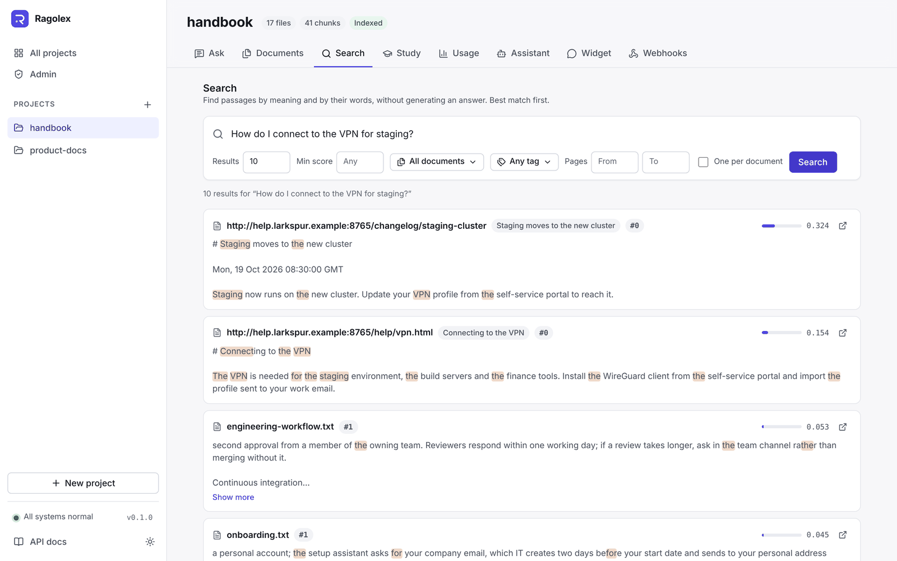
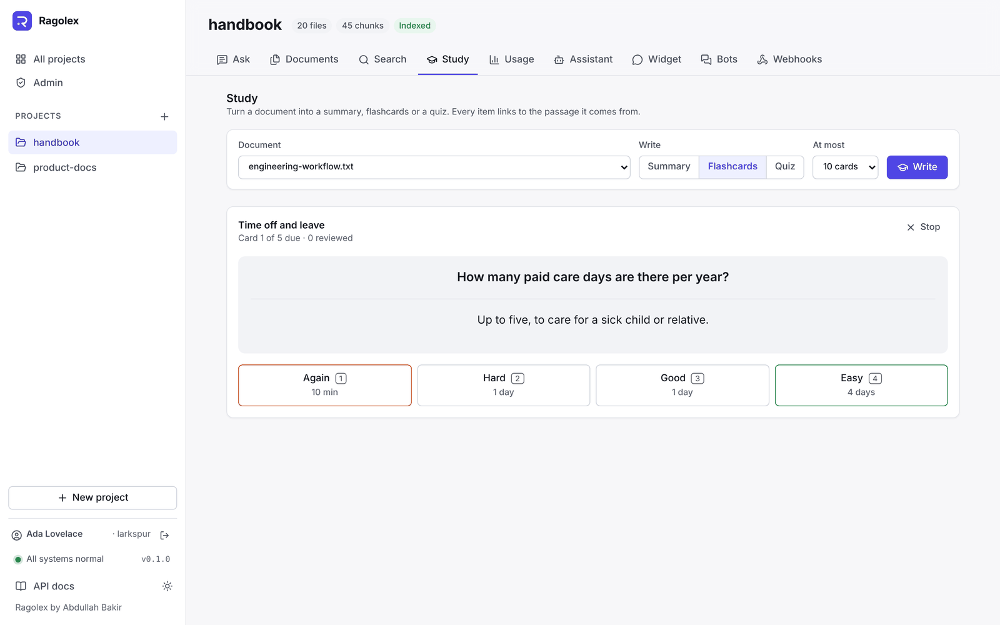
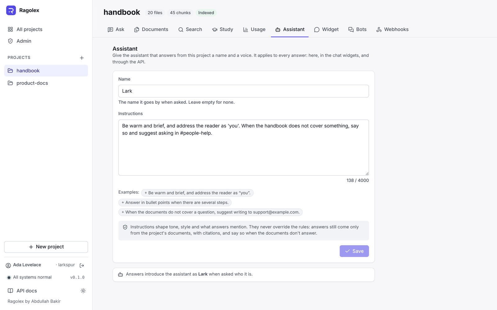
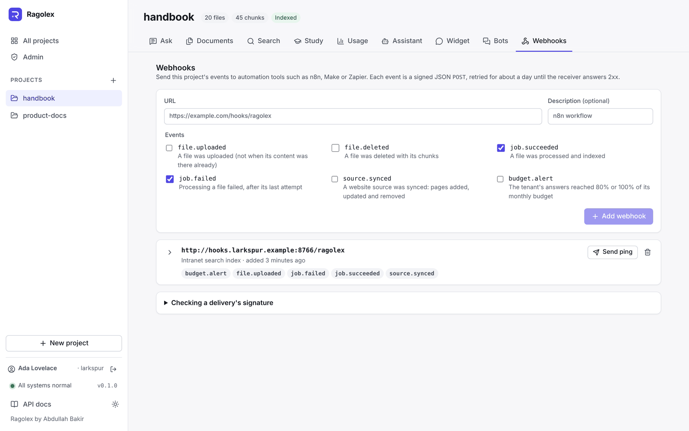

# Web app

The web app in `frontend/` is the interface for people: create projects, upload documents, ask questions and check usage, without writing a request by hand. It uses only the public API, so it shows what any other client can do.


## Pages

| Page | What it does |
|---|---|
| **Admin** (in the sidebar) | The tenant at a glance: answers, storage, tokens and cost this month against its limits, and its rate limit. With the `admin` scope (an owner's or admin's sign-in, or an `admin` key): the members, with their roles and when they last signed in (change a role, remove a member) and the invitations not accepted yet (invite an email with a role, its link shown once with a button to copy it and emailed when the server can; revoke one); the workspace's own domains (add one, with the TXT and CNAME records to add at its DNS provider and buttons to copy them, check its TXT record, remove one); single sign-on (the identity provider's issuer URL, client ID and secret, the role of new members, on or off, whether it is required (only an owner changes that), and the redirect URI to register, with a warning until the workspace has a verified email domain); the connections to Notion and Google Drive (connect one, which goes to the service to sign in and comes back with a message saying how it went; see each one's account, who connected it, how many sources use it and why its tokens were last refused; remove one no source uses); the API keys (create one with its scopes, shown once with a button to copy it; revoke one), the evaluation scores (each dataset's latest hit rate, recall, MRR and answer grades, with the change since the previous run of the same setup and the MRR trend, then every run), and the audit log, filtered by action. |
| **Projects** | All projects with their file, chunk and index counts. A new project is kept in the browser until its first file is uploaded, because the API creates a project with its first upload. |
| **Ask** | Conversations with the project's documents: follow-up questions build on the ones before, and a rewritten follow-up shows what was searched for. Past conversations are listed beside the page (in a drawer on narrow screens), each with its own address, and can be reopened or deleted. Questions are answered from the project's documents. Answers stream as they are written and can be stopped, formatted as the model writes them: paragraphs, headings, nested lists, bold, italics and code. Each `[n]` marker is a link to its source, and every source opens at its chunk in the document. A question the documents don't answer says so plainly. Each new answer shows its tokens, cost, time and prompt version (a reopened conversation keeps the prompt version; its usage is on the Usage page), and can be rated thumbs up or down, with a note on what was wrong. The settings set the number of sources, the minimum score, streaming, research mode (the model plans several searches for a question with several parts, and the answer lists what it searched for) and which documents or tags to answer from; a badge by the settings shows when answers use only some documents. |
| **Documents** | Drop PDF, Word, Markdown, HTML, text or source code files: each one is uploaded with a progress bar, then split into chunks and indexed by a background job on the server, with its state and indexing progress shown at each step. Files upload one after another while the server works on the ones before, and a failure the server will retry says so. Files list their size and chunk count; a file's chunks open in a side panel, a file can be re-processed with other chunking options, and deleted with its chunks after a confirmation. A file the project already has, even under another name, is not stored again and shows as already in the project. Tags group files into collections: give new uploads tags, edit a file's tags in place, and show only the files with a tag by picking it above the list (or clicking a file's tag). At the bottom of the page, a project can be deleted with everything in it once its name is typed. |
| **Sources** (on the Documents page) | Add a website, an RSS or Atom feed, or a GitHub repository (or one folder of it) by its address, or Notion pages or a Google Drive folder through one of the workspace's connections (with no address, everything the connection can read), with the most pages to keep, how often to sync it and any tags for its pages: its pages are fetched, indexed, and synced again on that schedule. Each source shows its pages, when it was last synced and is next due, and why its last sync failed, if it did; it can be synced now, opened to list its pages, or removed with or without its pages. |
| **Study** | A summary, flashcards or a quiz from one of the project's documents. Key points link to the pages or sections they come from; flashcards turn over one by one or all at once; quiz questions mark the right and wrong choices, explain the right one and keep the score. Flashcards can be saved to a deck, new or existing. Decks list how many cards are due; reviewing shows one card at a time, the answer on Space, and four grades (keys 1 to 4) with when each brings the card back. Decks export to Anki. |
| **Search** | Passages that match a query by meaning and by its words, best first, with their scores and the query's words highlighted. Narrow the search to some documents, tags and a page range, or take one passage per document. |
| **Assistant** | Give the project's assistant a name and instructions on tone, style and what to mention, with examples to start from; every answer follows them, in the web app, the widgets and the API, while still answering only from the documents. |
| **Widget** | Add chat widgets that websites embed to let their visitors ask the project: a name, a welcome message, a colour, a logo, the websites allowed to use it, and optionally tags, so it answers only from the documents that have them. Each widget shows its script tag with a button to copy it, and can be edited or removed. A live preview beside the list is the real widget, asking the project as a visitor would. |
| **Webhooks** | Add a URL that gets the project's events (uploads, deletions, finished jobs), shown its signing secret once with a button to copy it; send a ping; and see each webhook's recent deliveries: delivered, waiting to try again (and when), or failed, with the receiver's answer. How to check a signature is explained on the page. |
| **Bots** | Let people ask the project in Telegram, Slack or WhatsApp: pick the chat app, follow its setup steps, paste its credentials and give the bot a name and optionally tags, so it answers only from the documents that have them. A Telegram bot connects itself; a Slack or WhatsApp bot shows the webhook URL (and, for WhatsApp, the verify token) to paste into the app's settings, with buttons to copy them. Each bot shows its account in the chat app, when it last got a message and its last problem, if any; it can be turned off and on, or removed after a confirmation (its conversations stay). |
| **Usage** | The tenant's limits, when it has any: answers this month, storage and cost against their quotas and monthly budget. Its spending over the last 7, 30 or 90 days: a chart of cost or answers per day, and what each project and model cost. Questions asked, how many were answered, tokens and cost for the project, and the rated answers: how many were good and bad, each with its question, the note on it and a link to its conversation. |













When the server requires authentication (`AUTH_ENABLED=true`), a page that needs it sends people to **Sign in**, and back to that page after. They sign in with their email and password; with **Sign in with single sign-on**, with only their email, through their organisation's identity provider (offered by itself when a password is refused because the workspace requires it); or create an account (with a workspace of their own) on **Create an account**. The server keeps the session in an HttpOnly cookie, which the app never sees. **Forgot your password?** emails a link (when the server can send email) to the **Choose a new password** page. An invitation link opens **Join a workspace**: it says who invited whom to which workspace, and joins with a new account, or with the invited email's account once signed in. Tokens from these links are read from the address's `#` part, which browsers never send to a server, and taken out of the address bar at once.

Signed in, the sidebar shows the user, a switch between their workspaces and a button to sign out; **Account** lists the workspaces, changes the password and signs out. Apps and scripts can still use an API key: **Use an API key instead** on the sign-in page keeps one in the browser.

On a workspace's own domain (see [API › Your own domains](api.md#your-own-domains)), the sign-in page names the workspace (**Sign in to acme**) and offers no sign-up, since people join it by invitation, and the sidebar has no workspace switch: that domain always opens its workspace.

When chunks are not indexed yet, for example because no embedding model was configured during the upload, a banner offers to index them. The sidebar shows whether the API and the database are reachable.

The first question on the Ask page starts a conversation, which the server keeps: its address (`/projects/<name>/ask/<conversation id>`) can be reloaded or shared with anyone using the same server, and the Ask tab returns to the conversation last open.


It follows the system's light or dark theme, or the one chosen in the sidebar, and works on phones.


## How it is built

| | |
|---|---|
| Framework | Vue 3 with `<script setup>` and TypeScript, Vue Router; no UI framework, the styles are design tokens in `src/styles.css` |
| Build | Vite; `vue-tsc` type-checks every build |
| API client | `src/api/client.ts`: typed calls for every endpoint; errors become an `ApiError` with the API's signal and a readable message. Uploads use `XMLHttpRequest` for progress, streamed answers read Server-Sent Events from a `fetch` response (`src/api/sse.ts`), since `EventSource` cannot send a `POST` |
| State | Small composables in `src/composables/`: the project list, the current project, the upload pipeline, the questions on the Ask page |
| Tests | Vitest: the event-stream reader, the API client, sign-in and the account pages, citation parsing, formatting, the answer component and the chat widget. Playwright (`e2e/`): the main flows in a browser against the real API, signing up, inviting and managing members against a second API with authentication on, and axe accessibility checks of every page in both themes and at phone width; see [End-to-end tests](development.md#end-to-end-tests) |
| Chat widget | `src/widget/`: the script websites embed, without Vue, built by `vite.widget.config.ts` into a single `dist/widget.js` (about 8 kB compressed). It draws itself in a shadow root and builds answers from the same Markdown reader as the app; the Widget page imports it for its preview |
| Serving | nginx (unprivileged) serves the built files, sends every page path to `index.html`, caches hashed assets for a year, and forwards `/api`, `/docs` and `/openapi.json` to the API without buffering, so streamed answers arrive event by event |

Answers are formatted by a small Markdown reader (`src/lib/markdown.ts`) that turns them into a tree of plain strings; the page builds elements from that tree, so answer text is never rendered as HTML and a document cannot inject markup into the page. Source passages are shown with the line breaks of the PDF joined back into paragraphs; list lines keep theirs.

```
frontend/
├── src/
│   ├── api/            # Typed API client, Server-Sent Events reader, response types
│   ├── components/     # Sidebar, drop zone, source card, chunk panel, answer text, ...
│   ├── composables/    # Shared state and the upload pipeline
│   ├── lib/            # Formatting, citation parsing, error messages
│   ├── views/          # Projects, Admin, Account, project pages (Ask, Documents, Search, Study, Usage, Assistant, Widget, Webhooks, Bots), sign-in pages (auth/), not found
│   ├── widget/         # The embeddable chat widget (built into dist/widget.js)
│   └── __tests__/      # Vitest unit tests
├── e2e/                # Playwright end-to-end and accessibility tests
├── playwright.config.ts # Starts the stand-in models, the API and the app for them
├── vite.widget.config.ts # Builds the chat widget
├── Dockerfile          # Node build, then nginx
└── nginx.conf.template # API address and DNS resolver come from the environment
```

## Running it

With Docker, `docker compose up --build` serves it on **http://localhost:3000**. For development, run the API (see the [README](../README.md#quick-start)), then:

```bash
cd frontend
npm install
npm run dev     # http://localhost:5173
```

The nginx image reads two settings: `API_UPSTREAM` (default `http://app:8000`), the API's address, and `NGINX_RESOLVER` (default `127.0.0.11`, Docker's DNS), which resolves that address on each request so a restarted API container is still found.
