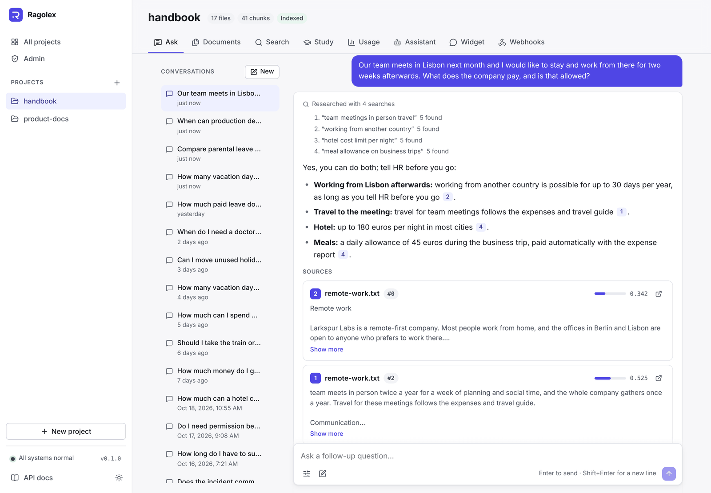
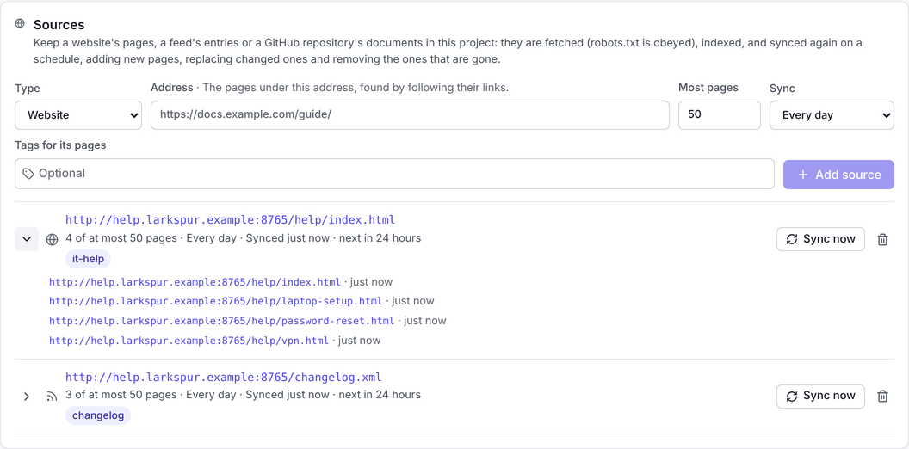
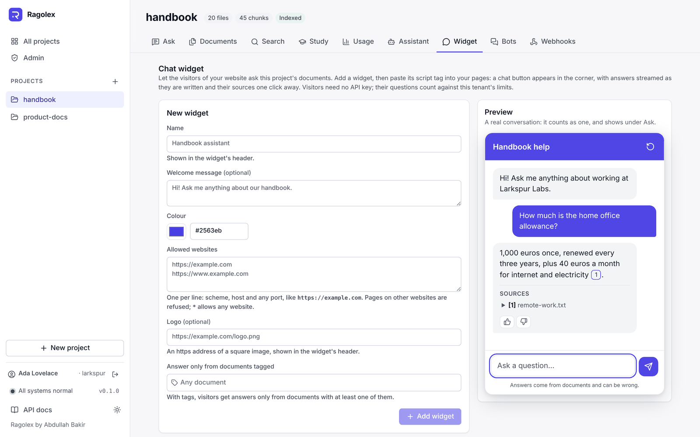
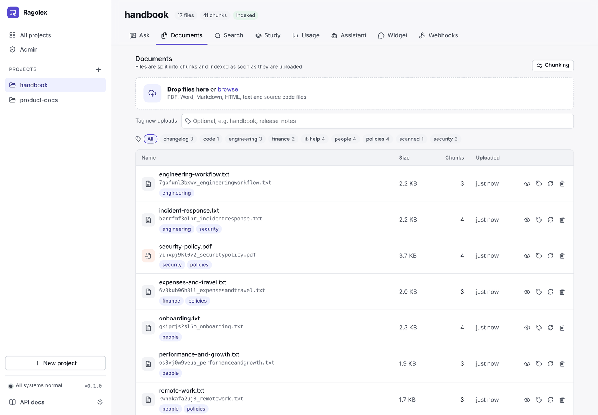
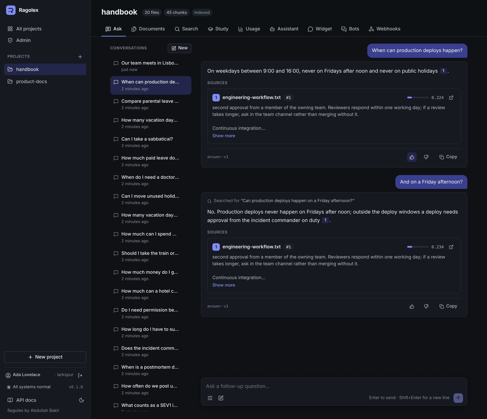

# Web app

The web app in `frontend/` is the interface for people: create projects, upload documents, ask questions and check usage, without writing a request by hand. It uses only the public API, so it shows what any other client can do.



## Pages

| Page | What it does |
|---|---|
| **Projects** | All projects with their file, chunk and index counts. A new project is kept in the browser until its first file is uploaded, because the API creates a project with its first upload. |
| **Ask** | Conversations with the project's documents: follow-up questions build on the ones before, and a rewritten follow-up shows what was searched for. Past conversations are listed beside the page (in a drawer on narrow screens), each with its own address, and can be reopened or deleted. Questions are answered from the project's documents. Answers stream as they are written and can be stopped, formatted as the model writes them: paragraphs, headings, nested lists, bold, italics and code. Each `[n]` marker is a link to its source, and every source opens at its chunk in the document. A question the documents don't answer says so plainly. Each new answer shows its tokens, cost, time and prompt version (a reopened conversation keeps the prompt version; its usage is on the Usage page), and can be rated thumbs up or down, with a note on what was wrong. The settings set the number of sources, the minimum score, streaming and which documents or tags to answer from; a badge by the settings shows when answers use only some documents. |
| **Documents** | Drop PDF, Word, Markdown, HTML or text files: each one is uploaded with a progress bar, then split into chunks and indexed by a background job on the server, with its state and indexing progress shown at each step. Files upload one after another while the server works on the ones before, and a failure the server will retry says so. Files list their size and chunk count; a file's chunks open in a side panel, a file can be re-processed with other chunking options, and deleted with its chunks after a confirmation. A file the project already has, even under another name, is not stored again and shows as already in the project. Tags group files into collections: give new uploads tags, edit a file's tags in place, and show only the files with a tag by picking it above the list (or clicking a file's tag). At the bottom of the page, a project can be deleted with everything in it once its name is typed. |
| **Websites** (on the Documents page) | Add a website by its address, with the most pages to keep, how often to sync it and any tags for its pages: its pages are fetched, indexed, and synced again on that schedule. Each website shows its pages, when it was last synced and is next due, and why its last sync failed, if it did; it can be synced now, opened to list its pages, or removed with or without its pages. |
| **Search** | Passages that match a query by meaning and by its words, best first, with their scores and the query's words highlighted. Narrow the search to some documents, tags and a page range, or take one passage per document. |
| **Assistant** | Give the project's assistant a name and instructions on tone, style and what to mention, with examples to start from; every answer follows them, in the web app, the widgets and the API, while still answering only from the documents. |
| **Widget** | Add chat widgets that websites embed to let their visitors ask the project: a name, a welcome message, a colour, a logo, the websites allowed to use it, and optionally tags, so it answers only from the documents that have them. Each widget shows its script tag with a button to copy it, and can be edited or removed. A live preview beside the list is the real widget, asking the project as a visitor would. |
| **Webhooks** | Add a URL that gets the project's events (uploads, deletions, finished jobs), shown its signing secret once with a button to copy it; send a ping; and see each webhook's recent deliveries: delivered, waiting to try again (and when), or failed, with the receiver's answer. How to check a signature is explained on the page. |
| **Usage** | The tenant's limits, when it has any: answers this month and storage used against their quotas. Questions asked, how many were answered, tokens and cost for the project, and the rated answers: how many were good and bad, each with its question, the note on it and a link to its conversation. |





When the server requires API keys (`AUTH_ENABLED=true`), the app asks for one, keeps it in the browser, and shows the tenant it signed in to, with a button to sign out. A refused key brings the question back.

When chunks are not indexed yet, for example because no embedding model was configured during the upload, a banner offers to index them. The sidebar shows whether the API and the database are reachable.

The first question on the Ask page starts a conversation, which the server keeps: its address (`/projects/<name>/ask/<conversation id>`) can be reloaded or shared with anyone using the same server, and the Ask tab returns to the conversation last open.



It follows the system's light or dark theme, or the one chosen in the sidebar, and works on phones.



## How it is built

| | |
|---|---|
| Framework | Vue 3 with `<script setup>` and TypeScript, Vue Router; no UI framework, the styles are design tokens in `src/styles.css` |
| Build | Vite; `vue-tsc` type-checks every build |
| API client | `src/api/client.ts`: typed calls for every endpoint; errors become an `ApiError` with the API's signal and a readable message. Uploads use `XMLHttpRequest` for progress, streamed answers read Server-Sent Events from a `fetch` response (`src/api/sse.ts`), since `EventSource` cannot send a `POST` |
| State | Small composables in `src/composables/`: the project list, the current project, the upload pipeline, the questions on the Ask page |
| Tests | Vitest: the event-stream reader, the API client, citation parsing, formatting, the answer component and the chat widget. Playwright (`e2e/`): the main flows in a browser against the real API, and axe accessibility checks of every page in both themes and at phone width; see [End-to-end tests](development.md#end-to-end-tests) |
| Chat widget | `src/widget/`: the script websites embed, without Vue, built by `vite.widget.config.ts` into a single `dist/widget.js` (about 8 kB compressed). It draws itself in a shadow root and builds answers from the same Markdown reader as the app; the Widget page imports it for its preview |
| Serving | nginx (unprivileged) serves the built files, sends every page path to `index.html`, caches hashed assets for a year, and forwards `/api`, `/docs` and `/openapi.json` to the API without buffering, so streamed answers arrive event by event |

Answers are formatted by a small Markdown reader (`src/lib/markdown.ts`) that turns them into a tree of plain strings; the page builds elements from that tree, so answer text is never rendered as HTML and a document cannot inject markup into the page. Source passages are shown with the line breaks of the PDF joined back into paragraphs; list lines keep theirs.

```
frontend/
├── src/
│   ├── api/            # Typed API client, Server-Sent Events reader, response types
│   ├── components/     # Sidebar, drop zone, source card, chunk panel, answer text, ...
│   ├── composables/    # Shared state and the upload pipeline
│   ├── lib/            # Formatting, citation parsing, error messages
│   ├── views/          # Projects, project pages (Ask, Documents, Search, Usage, Widget), not found
│   ├── widget/         # The embeddable chat widget (built into dist/widget.js)
│   └── __tests__/      # Vitest unit tests
├── e2e/                # Playwright end-to-end and accessibility tests
├── playwright.config.ts # Starts the stand-in models, the API and the app for them
├── vite.widget.config.ts # Builds the chat widget
├── Dockerfile          # Node build, then nginx
└── nginx.conf.template # API address and DNS resolver come from the environment
```

## Running it

With Docker, `docker compose up --build` serves it on **http://localhost:3000**. For development, run the API (see the [README](../README.md#quick-start)), then:

```bash
cd frontend
npm install
npm run dev     # http://localhost:5173
```

The nginx image reads two settings: `API_UPSTREAM` (default `http://app:8000`), the API's address, and `NGINX_RESOLVER` (default `127.0.0.11`, Docker's DNS), which resolves that address on each request so a restarted API container is still found.
